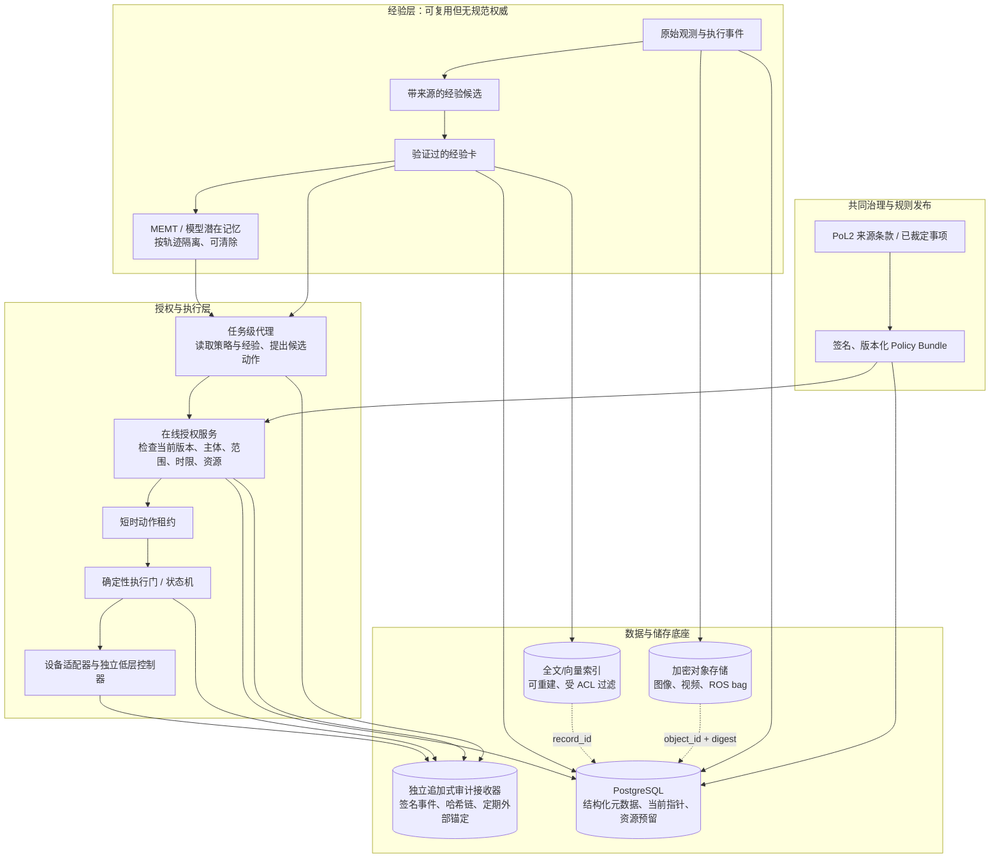
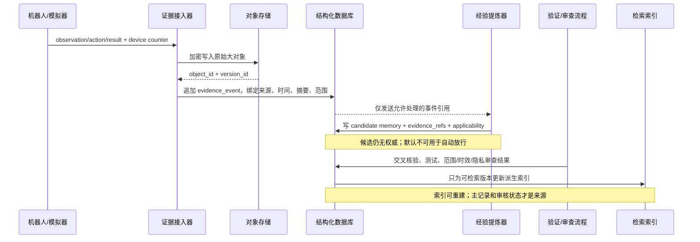
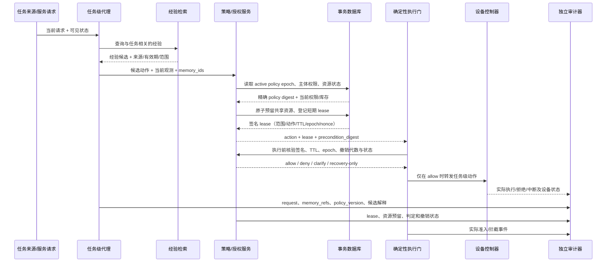

# PoL2 治理系统的经验记忆、权威、授权与审计：分层架构和储存方案

**版本：** 研究设计稿 v0.1

**日期：** 2026-10-29

**适用范围：** 具身代理对共享服务和稀缺运行资源的治理；先用于沙盒与仿真，不构成真实机器人安全认证。

## 结论

持续学习不应意味着“模型把历史压进一个状态，然后让这个状态决定规则和行动”。PoL2 治理系统需要保留四个独立问题：

1. **经验记忆：** 过去发生什么、哪些经验在什么条件下复用？
2. **规范权威：** 当前被共同体认可的规则是哪一版？谁按何种流程批准或修订？
3. **行动授权：** 这个主体现在能否对这个对象、执行这个动作、使用这份资源？授权何时失效？
4. **可审计记录：** 决策实际读取了哪些证据、规则和授权，执行结果如何？记录能否被篡改或补写？

四层共享可引用的 ID，但不能共享同一个可随意写入的“记忆”。经验能辅助判断，不产生权威；规则能约束动作，不自动授予具体权限；授权能开放一个有限动作，不覆盖规则；日志能让决定可复核，不证明传感器描述的事实必然真实。

建议架构：**PostgreSQL 保存结构化事实索引、规则当前指针、授权租约和事件元数据；对象存储保存经访问控制的图像、视频、ROS bag 等大对象；全文/向量索引只负责找候选经验；策略包使用签名版本发布；MEMT 类潜在状态属于隔离的轨迹记忆；独立审计接收器保存追加式、可校验的决策事件。** 先把接口和权限边界做清楚，再决定是否接入某个模型记忆后端。

## 1. 四层的权力边界

| 层 | 回答的问题 | 可写入的主体 | 决策时怎么读 | 权威级别 |
|---|---|---|---|---|
| 经验记忆 | 过去观察、执行、维修或失败了什么？ | 传感器/控制器写原始事件；提炼器只能提交候选；符合预设审核流程后才能标为可复用经验 | 按主体、任务、时效、来源和访问许可检索；返回来源与验证状态 | 证据/经验，不是规范 |
| 规范权威 | 当前适用哪一版 PoL2 条款和治理决定？ | 按已裁定治理程序授权的发布角色；AI 可提修订建议，不能自行把建议置为生效规则 | 精确读取策略包 ID、版本、摘要哈希、生效时间和撤销版本 | 规范来源 |
| 行动授权 | 此刻允许执行哪一个具体动作？ | 授权服务依据有效策略、主体凭证、资源状态和当前请求签发；撤销服务可立即提高撤销代数 | 执行前核验租约签名、范围、时限、策略版本、撤销代数、前置条件和资源预留 | 当前、窄范围、可撤销的许可 |
| 可审计记录 | 输入、规则、决定、动作、结果是什么？ | 设备与各服务追加事件；更正以新事件关联旧事件，禁止静默改写 | 复核员/审计器按权限重建完整因果链 | 证明记录完整性，不证明记录内容必真 |

应把“状态”再拆成四个独立标签，不用一个 `trusted=true`：

```text
evidence_status:     raw | corroborated | disputed | retracted
experience_status:   candidate | validated | scoped | expired | revoked
policy_status:       draft | approved | active | superseded | revoked
authorization_status: absent | active | expired | revoked | consumed
audit_status:        pending | committed | anchored | integrity_error
```

例如，传感器事件可以是完整入库且哈希正确（`audit_status=committed`），但内容仍未交叉验证（`evidence_status=raw`）；一条规则可以是已批准（`policy_status=active`），但这不代表某机器人获得该动作授权（`authorization_status=absent`）。

## 2. 架构图：四层与底层储存



**读取原则：** 向量检索只能返回带来源的经验候选；规则以精确版本读取；授权在临近动作执行时从当前版本和实时资源状态重新核验；执行与结果事件送到独立审计接收器。MEMT 快照可帮助模型回忆已核验经验，但不进入授权判定的权威路径。

## 3. 每一类数据放在哪里

| 数据 | 推荐主储存 | 允许的改变方式 | 不应这样做 |
|---|---|---|---|
| 机器人原始传感事件 | 设备本地加密缓冲 → 加密对象存储；PostgreSQL 存对象 ID、设备、时间、位置/任务范围、内容摘要和访问级别 | 按明确保留期追加；新版本/更正另建对象；敏感内容按适用政策到期删除 | 把所有图像/视频永久放进不可删除日志 |
| 经提炼的经验记录 | PostgreSQL 关系表；正文按大小放对象存储；全文与向量索引均可重建 | 候选→验证→定范围→过期/撤销；不覆盖旧版，使用 supersedes 关系 | 只存一段无来源文本或一个 embedding |
| PoL2 条款、裁定与策略包 | 源文件仓库 + 签名发布包/只读制品；数据库仅存 active version 指针和生效/撤销代数 | 新版本通过批准流程发布；旧版保留用于重建决策 | 由模型记忆总结取代原文，或让在线 Agent 改 active pointer |
| 资源余额和预留 | PostgreSQL 事务表（必要时按资源/社区分区）；唯一约束和并发控制 | 预留、扣减、释放都写事务并记事件；失败需重试或明确拒绝 | 先查余额再异步扣减，造成两个机器人同时花掉同一资源 |
| 授权租约 | PostgreSQL 当前授权/撤销状态为源；执行端短 TTL 缓存签名租约 | 签发新租约、消费、到期或撤销；不可静默延长 | 用长期 API token 代表每一个现场动作的授权 |
| 审计事件 | 独立追加式事件表/日志接收器；定期复制到独立管理域；重要清单可选择 WORM | 新事件引用旧事件；更正、撤销、隐私处理都留下受控记录 | 仅把数据库 WAL 当作业务审计日志，或让业务服务可改写审计记录 |
| MEMT 等模型状态 | 按用户/社区/设备/任务轨迹隔离的加密快照；明确生命周期与删除策略 | 新快照替代旧快照；经允许可销毁密钥/状态；读写操作有日志 | 把不同社区状态合并为共享状态，或把潜在记忆当作公众同意 |

### 推荐的工程组合

**小型沙盒原型：** SQLite/PostgreSQL 任选其一作为显式治理状态的唯一真源，文件系统/本地加密对象目录存模拟器证据，确定性执行门单独进程，JSONL 审计日志追加写。先验证 ID、版本和授权语义，无需上向量数据库、区块链或分布式事件总线。

**多机器人/公共服务试点：** PostgreSQL + 加密对象存储 + 独立审计接收器。若经验库规模和查询延迟需要，再加 Postgres 全文检索或 pgvector；向量及 embedding 只是派生索引，删/改主记录后必须可重建。高影响任务的授权和资源预留留在关系事务里，不让向量服务做许可判断。

PostgreSQL 的 WAL 支持崩溃恢复和时间点恢复；但这只是数据库持久性能力。共享库存或机器人时隙的并发预留要用事务约束，并为串行化失败设计重试/冲突响应。[PostgreSQL WAL 文档](https://www.postgresql.org/docs/current/wal-intro.html) · [事务隔离文档](https://www.postgresql.org/docs/current/transaction-iso.html)。

若选 pgvector 的近似索引，官方文档指出 `WHERE` 过滤发生在近似索引扫描之后；多租户共享近似索引还会使一个租户的向量影响另一租户的召回与速度。对私密/社区隔离的经验，需先按租户/权限分区或采用精确搜索，再评估近似索引；不能只在返回结果后过滤。[pgvector filtering 与 multitenancy](https://github.com/pgvector/pgvector#filtering)。

对象锁（WORM）适合少量需证明“未被静默改写”的发布清单或审计摘要；它会限制更改/删除，因此不应默认施加于所有原始影像。S3 Object Lock 要求对象版本控制，且锁只作用于指定版本；这是具体云存储功能，不是法律合规保证。[Amazon S3 Object Lock](https://docs.aws.amazon.com/AmazonS3/latest/userguide/object-lock.html)。

## 4. 写入流程：观察不能自动变成经验



经验记录建议至少含：

```json
{
  "memory_id": "mem-uuid",
  "kind": "episodic_fact | procedural_experience",
  "status": "candidate | validated | scoped | expired | revoked",
  "scope": {"community": "c-17", "robot_class": "panda", "task_family": "shared-delivery"},
  "valid_from": "2026-10-29T00:00:00Z",
  "valid_until": "2026-11-29T00:00:00Z",
  "evidence_refs": ["event-uuid", "object-version-id"],
  "provenance": {"agent": "extractor-v3", "source_model": "model-revision", "review": "review-record-id"},
  "applicability": {"preconditions": ["..."], "exclusions": ["..."]},
  "policy_refs": ["clause-id@policy-digest"],
  "supersedes": [],
  "access_class": "community-private",
  "retention_class": "operational-90d"
}
```

`confidence` 可以记录模型或审查者对一项提炼的把握，但不能把数值当作政策授权或客观真值。来源缺失、版本不明、前置条件不符、争议未决或过期的记录，应返回“不可据此决策”，而不是静默加入提示。

W3C PROV-O 提供把 Entity、Activity、Agent 以及派生关系表达为互操作 provenance 的标准词汇。可以借用其概念表达“此经验由哪些观测、工具、版本与审核活动产生”，不必为了实验第一版实现整套 RDF 系统。[W3C PROV-O Recommendation](https://www.w3.org/TR/prov-o/)。

## 5. 读写时序：代理提出动作，授权服务决定能否执行



关键点：

- **在线授权不依赖模型回答“我记得有权”。** 每个高影响动作核验一个签名、短时、限主体/设备/动作/资源的 capability lease。
- **租约不等于规则。** 租约引用一个确切 `policy_digest` 和 `authorization_epoch`；系统不能只验证“签名有效”，还须验证这个 epoch 仍然有效且未撤销。
- **资源预留与授权在同一原子事务内。** 两个机器人争同一批共享库存时，由数据库解决竞争；只基于模型读到的旧库存做决定会形成超额分配。
- **运行时关卡不等于低层安全控制。** 策略服务决定任务动作是否可发给适配器；伺服/飞控的硬实时闭环与独立安全停机机制仍由设备控制栈负责。

## 6. 撤权、规则更新、离线和安全恢复

### 撤权与规则更新

1. 治理程序批准策略新版本，生成签名 bundle；数据库将 `active_policy_epoch` 原子切换到新值。
2. 撤权时增加 `revocation_epoch`，使此前签发的旧租约在执行门下一次校验时失效；发布失效通知只用于加速缓存更新，不作为唯一撤销机制。
3. 每次机器人状态转换前，执行门检查租约期限、撤销 epoch、策略版本、动作前置条件和设备状态。长任务应拆成短租约/分段检查点。
4. “停止正在进行的任务”与“把物体放稳/机器人移出通道”是两类授权。可以预先定义单独的、最小能力的恢复 lease（例如仅允许回到安全位且不得完成原目标），并单独审计。

### 网络中断

设备边缘端可缓存：近期签名策略包、单个动作的短租约、最小安全状态机和未上传的签名事件。策略缓存设置硬到期时间和撤销最大滞后；超时后不允许启动新任务。缓存额度有限的、预先规定的恢复动作可用于把设备/物体转入稳定状态。不得让“离线时沿用最后一次授权”变成无限期放行。

### 修订与隐私删除

原始媒体、可识别个人的数据、经验摘要和审计索引应分开存储与定期限留。追加式审计不要求把所有敏感内容永久明文保留：审计事件可保留受控标识、内容摘要和访问/删除事件；原始对象可按批准的保留策略删除或销毁密钥。哈希本身若仍能关联到个人，也不能简单假定它已匿名。具体保留和删除规则需由部署地适用制度决定。

WORM 可能与更正或删除需求冲突，因此先对“哪些记录必须不可变、保留多久、哪些内容需能清除”做数据分类，再选择锁定范围。对事件日志可保留追加式的更正/撤销事件；不要覆盖原决定，也不要让更正重新授予已撤回权限。

## 7. 审计日志的能力与边界

建议每一项执行决定形成一条有序事件：

```text
event_id, device_id, device_counter, server_received_at,
request_id, subject_id, resource_id,
memory_record_ids[], evidence_object_versions[],
policy_bundle_id, policy_digest, authorization_epoch,
lease_id, proposed_action, gate_result, executed_action,
precondition_digest, outcome, error_code,
previous_event_hash, event_hash, signer_key_id
```

日志服务应由业务写入角色以外的密钥/服务身份签名；按设备序列号或流分区维护顺序，定期把 hash-chain 根摘要复制到独立管理域。设备离线时用单调递增计数器标注本地顺序；服务器时间只用于接收时间，不可伪造为设备观测时间。

哈希链能让已记录的内容被事后改写时更容易被发现；它不能证明事件完整、传感器没有被欺骗、模型没有漏记，也不能证明策略解释正当。独立日志接收、设备端签名、外部锚点、完整率监控和现场对照仍然重要。NIST 日志管理指南把日志流程覆盖到生成、传输、存储、访问与处置；这支持把日志当作完整生命周期系统来设计，而不是只选一种数据库。[NIST SP 800-92](https://csrc.nist.gov/pubs/sp/800/92/final)。

## 8. 具体技术建议和选型边界

### PostgreSQL：真源与并发资源预留

建议的核心表族（只示范边界，不是最终 schema）：

```text
evidence_events       append-only 原始事件元数据
experience_records   候选/已核验的经验卡及版本关系
policy_bundles        已发布策略摘要、签名和状态
policy_activation     当前版本与 authorization_epoch
resource_inventory    当前可用资源/容量
resource_reservations 原子预留，带主体、范围和失效时间
authorization_leases  限定动作的短时票据
decision_events       可审计的决策和执行事件
```

跨机器人并发竞争库存时，用唯一约束/条件更新和事务序列化保护不变量；处理串行化失败要重试有限次数并可见地返回冲突，不能静默改成 allow。WAL、数据库备份和 PITR 用于恢复运营数据库；恢复到历史时刻后必须再对照最新的外部撤销 epoch，避免把旧授权“恢复活”。

### 对象存储：高体积证据与分级保留

图像、深度帧、点云、视频和 rosbag 走加密对象储存。对象键用不可猜 ID；数据库只保留 object version、digest、时间、设备、范围、访问级别和 retention class。研究者可在授权范围内拉取；运行时代理只得到经裁剪或摘要的观察。

不要默认把所有对象设为不可删除。可以对策略发布清单、审计批次根摘要和经过隐私审查的事故材料使用有限期 WORM；对敏感原始媒体使用访问控制、短期保留和可审计的删除流程。

### 搜索索引：权限过滤和可重建

检索顺序建议为：主体/社区 ACL → 当前时间有效范围 → 任务/设备范围 → 候选排序 → 返回原始记录引用 → 在策略服务前再次校验。embedding 不包含授权；向量相似度也不代表证据质量。索引丢失时从 PostgreSQL 主记录重建，不得把索引备份当作唯一记忆库。

对于小型受限库，可先 SQL 过滤后精确排序；多租户规模变大时再按租户分区/隔离索引，量化性能和召回损失。pgvector 的 ANN 查询在索引扫描后应用过滤条件，因此一个共享 HNSW 索引不能天然保证租户间召回隔离；该工程事实也会造成权限过滤后的结果不足，应以分区/精确查询和实际 ACL 测试来验证。[pgvector 官方说明](https://github.com/pgvector/pgvector#filtering)。

### MEMT 状态：记忆后端，不是公共账本

MemT-1.0 客户端支持保存和恢复每个 session 的 memory state，同时允许关闭 memory 读写。可借鉴为“每个任务轨迹可持久化、可继续、可隔离”的交互能力；但 state snapshot 要按可能含有个人信息/历史行动的敏感数据处理。建议按社区/主体/任务分别加密，不共享写密钥，快照显式列出创建模型版本、写入策略版本、来源事件和生命周期。[官方项目的 snapshot 示例](https://github.com/MemTensor/MemT-1.0#save-and-resume)。

技术接口至少应提供：

```text
write_candidate(memory, evidence_refs) -> candidate_id
validate(candidate_id, reviewer_or_test_record) -> approved_record_id
retrieve(query, principal, scope, as_of) -> [record_ref, provenance, status]
supersede(record_id, replacement_id, reason_event) -> event_id
revoke(record_id, reason_event) -> event_id
delete_payload(object_ref, approved_retention_action) -> deletion_event_id
```

`retrieve` 不能返回没有 provenance 的正文；`validate` 不能改写策略包；`revoke` 不应清空审计轨迹；`delete_payload` 不得删除依法/制度仍要求保留的审计信息，也不得伪称摘要哈希代表原始资料仍在。

## 9. 故障与攻击：逐层降级

| 情况 | 错误的混层表现 | 推荐降级 | 仍不能保证的事 |
|---|---|---|---|
| 记忆注入/错误经验 | 检索到即当作“已验证事实” | 保持 candidate 状态；没有独立来源/审查不影响授权；记录关联源头 | 审查者和原始传感器也可能被攻破 |
| 过期或被撤销规则 | 缓存命中旧规则就继续执行 | 当前 epoch/时限检查失败则拒绝新动作；另发窄权限恢复 lease | 网络断开期间无法立即获知远端撤销，需约束租约时长 |
| 记忆越权或跨社区泄露 | 共享模型状态携带前一社区信息 | 按主体/社区隔离索引、数据库行权限、模型状态密钥和缓存 | 数据库管理员/模型提供方仍是信任边界 |
| 审计记录被补写 | 业务服务同时能执行和重写自己的日志 | 独立接收器、签名身份、hash 链和外部根锚；监控缺号 | 不能证明记录以外的事情没有发生 |
| 传感器或设备伪造 | 日志有签名便称“事实为真” | 设备签名、校准记录、多模态交叉证据、维修状态 | 多源可能共因失效，签名只证明设备身份/字节来源 |
| 并发争抢共享资源 | 两个代理各自读到同一可用余额 | 事务化 reservation、唯一约束、冲突时重试或显式未获批 | 分配规则本身是否正当仍需治理决定 |
| 数据库/网络失联 | 把旧 token 或模型记忆当作离线永久授权 | 新任务停发；本地只执行短租约内动作或预定恢复动作；边缘事件签名排队 | 不能提供网络隔离下即时全局最优分配 |
| 删除/更正请求 | 直接改写不可变日志或永久保留全部 raw data | 分离原始 payload 与事件索引；受控删对象/密钥并追加处置事件 | 特定法律与机构义务需部署地审查 |

## 10. 面向公共品服务的落地顺序

以共享配送机器人为例，每项需求生成 `service_request_id`，每份库存/电池/机器人时隙生成 `resource_id`。政策规则决定优先级的权威来源与修订程序；memory 可以提示类似历史需求的配送路线、损耗和故障，不得自行提升某个群体的优先等级。授权服务检查当前请求、已批准规则和真实资源预留；审计层记录每类群体的排队和完成结果，再用隐私安全的汇总指标评估可及性。

建议分四阶段：

1. **合同阶段：** 冻结各层 JSON/API 契约；写出候选、验证、过期、撤销、授权租约和审计事件状态转换。公共福利条款仍待裁定时，显式列为未纳入规则集。
2. **影子记忆：** 代理读候选与已验证经验，但输出不控制执行；检查 provenance 缺失、过期记忆和跨社区召回。
3. **沙盒授权：** 接确定性门与资源 reservation，在任务模拟中测试授权撤销、事务竞争和恢复分支；主指标同时报告服务覆盖率、等待时间、合法任务误拒和违规动作漏放。
4. **硬件在环：** 验证断网、传感器漂移、急停和恢复权限；模型只给任务级候选，不进入伺服实时环。任何实机部署需单独安全论证。

这一路线先回答“分层接口和储存能否正确隔离权力、保留证据”，再问“MEMT 是否比普通文本经验库更好”。若一开始同时换记忆模型、治理规则、权限签发和控制栈，实验即使成功也无法定位是哪层带来效果。

## 参考资料

- MemTensor Team. [MemT-1.0: Towards Memory-Native Evolution, v2](https://arxiv.org/html/2610.26825v2)；[官方 snapshot/恢复示例](https://github.com/MemTensor/MemT-1.0#save-and-resume)。
- W3C. [PROV-O: The PROV Ontology](https://www.w3.org/TR/prov-o/)（来源与派生关系表达）。
- PostgreSQL. [WAL](https://www.postgresql.org/docs/current/wal-intro.html)、[事务隔离](https://www.postgresql.org/docs/current/transaction-iso.html)。
- pgvector. [Filtering 与 multitenancy 文档](https://github.com/pgvector/pgvector#filtering)。
- Amazon S3. [Object Lock](https://docs.aws.amazon.com/AmazonS3/latest/userguide/object-lock.html)（WORM 功能及对象版本语义）。
- NIST. [SP 800-92: Guide to Computer Security Log Management](https://csrc.nist.gov/pubs/sp/800/92/final)（日志全生命周期管理）。
- 本设计承接 [MEMT-1.0 与 PoL2 公共品时代](memt-pol2-public-goods.md)，并遵守本仓库 [`AGENTS.md`](../AGENTS.md)、[条款来源约定](../contracts/README.md) 与[开放裁定队列](../rulings/OPEN.md)。
