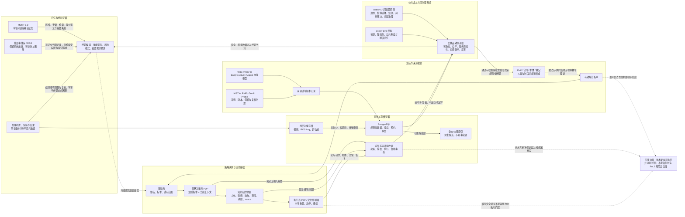
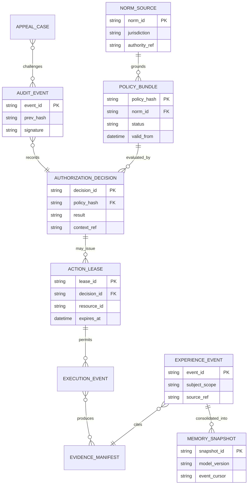
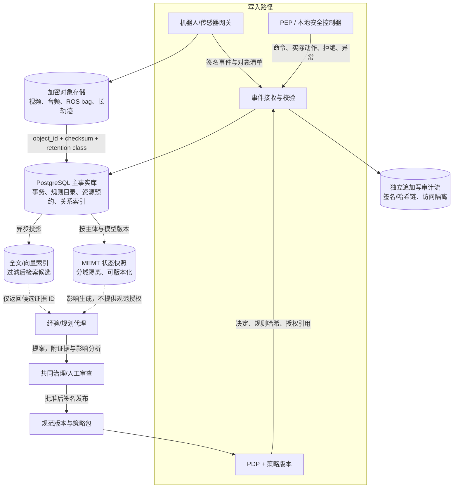

# PoL2 公共品治理的跨轮记忆：完整调研图与分析报告

> 更新时间：2026-10-29。本文围绕一个具体设计问题：治理系统怎样跨轮积累经验，同时让经验记忆、规范权威、行动授权和可审计记录保持不同的信任边界。研究重点是具身智能参与共享服务与公共品治理时的系统架构，不把技术方案当作 PoL2 条款解释。

## 结论先行

系统可以“从经验中学习”，但学习结果只能成为带出处、带置信和可撤回的**建议性知识**；它不能自行变成规则、权限或事实裁决。建议将四类状态分置：

1. **经验记忆**回答“过去发生了什么、什么可能有用”；由 MEMT 类模型状态、检索记忆和来源事件共同构成。
2. **规范权威**回答“当前经共同程序认可的规则是什么”；由签名、版本化、可追溯的规则登记与裁定流程构成。
3. **行动授权**回答“这个主体现在可对哪个资源做什么”；使用短时、窄范围、可撤销的授权票据，并在执行点再次校验。
4. **审计记录**回答“当时系统拿到了什么输入、依据哪个规则、谁/什么获准做了什么、发生了什么结果”；以追加写事件为主，明确完整性证明不等于事实真实性。

这四层之间应是单向、显式、可审查的接口：**经验可提案，程序可采纳；规则可约束，授权可放行；执行与决定均留下可追溯记录。**任何模型摘要、向量相似度、成功轨迹或审计哈希，都不能单独充当规范授权。

## 1. 完整调研图：证据如何汇合到设计

**阅读图的方式。**实线表示允许的数据/控制流；虚线表示受限的提案、反馈或认识边界。策略引擎和运行时安全控制执行已批准的约束；MEMT 或检索系统帮助找出候选经验，但不能给自己授予规范权威。公共品评价通过申诉、审查和有权程序才可能改变规则。

## 2. 研究范围、证据等级与限制

本轮采用面向问题的定向调研，优先查看论文原文/项目仓库、标准组织规范、官方技术文档和公共治理框架。结论分四种：

| 标记 | 证据类型 | 可支持什么 | 不能支持什么 |
|---|---|---|---|
| **E1 规范/官方文档** | W3C、IETF、NIST、OPA、PostgreSQL、云存储官方文档 | 数据模型、技术能力、建议流程及实现边界 | 某个 PoL2 规则的正当性或公共品效果 |
| **E2 论文/预印本** | MEMT、具身运行时治理、AI commons 研究 | 特定方法在论文设定内的机制或实验结果 | 真实部署、安全保证、普遍因果效果 |
| **E3 工程推论** | 结合多类证据提出的架构设计 | 可实施的候选分层、接口、存储方案 | 已被 NaturalDAO 生产系统实现或验证 |
| **E4 未决规范** | NaturalDAO `rulings/OPEN.md` 的 N-01 | 明确当前尚未解决的问题 | 不得用技术设计替代尚未作出的裁定 |

这不是穷尽所有相关文献的系统综述，也没有对所有记忆产品做基准评测。日期是 2026-10-29；MEMT arXiv v2 为预印本。NaturalDAO 现有门禁编译器没有接入模型，已有具身模拟探索不能证明真实机器人安全、净公共品收益或 PoL2 合规效果。

## 3. 证据链与研究发现

### 3.1 MEMT 说明“记忆能随交互更新”，不说明“记忆有治理权”

MEMT 1.0 的关键价值是把模型参数化记忆和常规上下文/检索分开处理，以本地可更新的记忆状态影响后续生成；论文还研究读取、写入、路由和固定容量状态。它启发了“运行中积累、必要时巩固”的机制。但神经状态的压缩必然带有信息损失与覆盖风险；读取结果是模型可用表征，不是带证据的原始历史，也没有共同体授权语义。

因此应把 MEMT 状态视为**用户/主体限定的可重建派生物**。每个记忆状态须绑定主体、租户/组织、任务域、模型与适配器版本、创建时间、来源事件游标、保留策略和同意/授权范围；更换规则版本不能静默改写旧记忆；撤销或删除需能识别快照、备份和派生索引。关键决策仍引用可查的事件/证据 ID，而非只引用模型“记得”。

论文报告的速度、存储与基准表现，只适用于其模型、历史长度和评测设置；不能外推成机器人任务效果、跨主体记忆可靠性或公共资源分配公平性的证据。项目代码与模型权重的许可证边界也需逐项检查，不能把论文许可自动视为代码/权重许可。

### 3.2 规范权威要独立于“最常被召回的经验”

OPA 的 bundle 和 decision logging 展示了可行的工程分工：规则可按版本/包分发，决策日志携带查询、结果及关联元数据，并可在上传前遮蔽敏感字段。这可以借鉴为 PoL2 规范登记的**技术载体**：候选变更、审查/表决/裁定记录、签名规则包、当前生效版本、适用主体与范围、撤回/替代关系各自可追溯。

但策略引擎只会执行输入给它的规则。它不能证明规则经过了适当共同治理，也不能判断文本是否被正确解释。因此需保存“规则文本/机器规则的对应关系、来源裁定、批准主体/程序、版本哈希、有效期和争议状态”；没有有权来源的机器规则应阻断部署或明确标记为试验性。NaturalDAO 当前 N-01 明确指出第 7 章公共福利条款是否登记、如何机器化仍待裁定；本报告提出的是治理接口，不补写该裁定。

### 3.3 授权是短周期的当前事实，不应永久沉淀为记忆

共享机器人或服务代理的权限取决于实时资源占用、设备状态、用户同意、地点、当前制度版本和安全状态。若把“上次获准”固化进长时记忆，资源状态或规则变化后就可能产生越权。授权应使用最小权限、明确资源与动作、短时效、唯一请求/nonce、规则版本绑定，并在执行端再次校验；撤销须传播到执行端，断网时要定义安全降级策略（限定缓存期限、危险动作禁止或回到人工接管）。

IETF OAuth 撤销/令牌实践可启发令牌生命周期，但机器人动作授权不是 OAuth 本身。PoL2 设计应明确决策点（PDP）签发与策略评估，执行点（PEP）本地强制，急停/碰撞/越界控制器有独立故障路径。授权日志要记录“被允许的具体动作和范围”，而不是只记一个 `allow=true`。

### 3.4 审计要同时保留过程、出处、删除依据和争议状态

W3C PROV-O 提供 Entity、Activity、Agent 及派生关系的互操作来源模型；NIST AI RMF 及 GenAI Profile强调来源、版本、保留、评估与事故复盘。用于本系统时，可把观测、策略包、决策、授权票据、动作命令、执行结果、人工干预和申诉分别建模，再用 `used / wasGeneratedBy / wasAssociatedWith / wasDerivedFrom` 等关系串联。

审计日志的防篡改、签名或哈希链只能增加事后改写的可发现性，不能证明传感器没撒谎、评估器没偏差或当事人已同意。须记录设备校准/固件版本、时间同步、数据缺口、人工覆盖、采样策略和不确定性；敏感数据最小化、字段遮蔽、访问留痕、保留期限和删除例外需成为设计的一部分。

### 3.5 公共品需要共同治理与结果评价，软件门禁本身不等于公共品

Ostrom 的共同资源研究强调资源边界、与地方条件相符的规则、受影响者参与集体选择、可信监测、渐进制裁、低成本纠纷解决、自治权承认和嵌套治理等原则。UNDP 对数字公共基础设施强调包容、互操作、可信治理与公共利益。这些框架指向一个重要结论：日志齐全、模型有记忆、机器人有安全门禁，都不足以说明服务公平或共同体控制成立。

对具身共享服务应增加可核验的结果层：谁能获得服务、等待/拒绝如何分布、稀缺资源如何分配、弱势群体受何种影响、机器人造成何种外部性、服务失败如何申诉/补偿、谁承担维护成本。治理变更需监测这些指标；不能只以任务成功率、吞吐量或“总拦截率”作为公共价值代理。

## 4. 推荐的逻辑数据模型

下表是建议的数据分层，不是现存生产架构。主事实尽量保存为追加事件和版本化实体；大文件和模型状态外置，搜索向量由规范记录派生并可重建。

| 层 | 主要对象 | 建议字段/键 | 写入主体 | 更新/删除语义 |
|---|---|---|---|---|
| **经验记忆** | `experience_event`, `memory_snapshot`, `skill_candidate` | `event_id`, `subject_scope`, `source_ref`, `model_version`, `created_at`, `confidence`, `expiry`, `consent_ref`, `snapshot_cursor` | 受控采集器、代理提案接口 | 原始事件按保留规则；快照可重算；反馈/纠错以新事件追加，不静默覆盖 |
| **规范权威** | `norm_source`, `ruling`, `policy_bundle`, `policy_relation` | `norm_id`, `jurisdiction`, `approval_ref`, `version`, `hash`, `valid_from/to`, `status`, `supersedes` | 有权治理流程与签名发布器 | 不原地编辑已生效版本；新版本替代/暂停旧版，争议状态显式 |
| **行动授权** | `authorization_decision`, `action_lease`, `revocation` | `principal`, `resource_id`, `action`, `constraints`, `policy_hash`, `issued_at`, `expires_at`, `nonce`, `revoked_at` | PDP/授权服务；PEP 消费 | 短时到期，单次/有限次数；撤销事件追加；PEP 每次动作复核 |
| **审计记录** | `audit_event`, `evidence_manifest`, `appeal_case` | `event_id`, `prev_hash`, `signature`, `actor`, `input_refs`, `decision_ref`, `action_ref`, `outcome_ref`, `privacy_class`, `retention_class` | 决策服务、设备网关、独立审计接收器 | 追加为主；纠错以更正事件；删除按法律/政策执行并留最小化 tombstone/删除证明 |

### 关键关系

**数据隔离关键点：**`policy_hash`把授权决定锁定到评估时的规范版本；`event_cursor`说明记忆快照使用了哪些经验事件；`source_ref`把模型总结拉回来源；`lease_id`将动作权限限制在一个资源与期限；`appeal_case`让治理争议与执行证据能连接但不自动改变规则。

## 5. 物理储存方案与取舍

### 储存组件选择

- **PostgreSQL 作结构化事实源。**事务、外键、唯一约束和可串行化事务适合预约、资源配额、规范状态与撤权竞态；冲突/序列化失败需应用层重试。WAL 支持崩溃恢复与时间点恢复，但它并不自动构成完整业务审计，也不保证日志外的对象一致。
- **对象存储放大体积证据。**视频、点云、音频和 ROS bag 以加密对象存储、内容校验和、对象版本和明确保留类管理。WORM/Object Lock 可用于指定类别的不可变留存，但必须与个人数据删除义务、法定保留和访问控制一起设计，不能默认所有传感数据永久锁定。
- **全文/向量库仅作派生检索索引。**以 PostgreSQL/pgvector 或独立搜索服务做候选召回，并强制主体/权限过滤、版本过滤、来源回链。近似向量索引可能先扫描再过滤，因而召回率和租户隔离要用数据规模与过滤条件实测。检索命中不是事实判断，最终依据回到规范/事件源。
- **MEMT 状态是可替换的派生层。**按代理主体、机构/项目、任务域进行隔离；禁止把不同主体的个人轨迹混进全局共享状态，除非用途、授权、治理程序与退出机制明确。每个快照保存模型版本、事件游标、生成器版本、保留与删除元数据。
- **审计接收器独立于业务写入。**服务组件将决定和执行结果同时写入业务数据库与独立审计流；定期封存/签名并做恢复演练。独立性可减少单服务被攻破时同时改写事实与审计的风险，但仍需密钥管理、外部时钟/设备证据及审计访问治理。

## 6. 运行时生命周期：一次动作如何闭环

```mermaid
sequenceDiagram
  participant M as MEMT/经验检索
  participant A as 规划代理
  participant PDP as 规范决策点
  participant PEP as 执行门禁/安全控制器
  participant DB as 事实库与对象存储
  participant LOG as 独立审计流
  participant G as 治理/申诉程序
  M->>A: 带来源的候选经验与置信信息
  A->>PDP: 动作意图、资源、主体、当前上下文
  PDP->>DB: 读取当前有效签名规范和资源状态
  PDP->>LOG: 记录策略哈希、输入引用、判定理由码
  PDP-->>A: 拒绝或短时窄范围授权票据
  A->>PEP: 动作命令 + 票据
  PEP->>PDP: 检查有效期、nonce、撤销与状态版本
  PEP->>DB: 保存执行事件及大对象证据清单
  PEP->>LOG: 记录执行/拒绝/急停/偏离
  PEP-->>A: 实际结果与故障状态
  LOG->>G: 异常、申诉或定期抽样复核包
  G->>DB: 裁定纠错/风险标签/规则变更的来源
  G-->>M: 仅将批准的可学习信号回馈记忆层
```

## 7. 威胁模型与必须验证的失效模式

| 失效/攻击 | 可能后果 | 控制与验证 |
|---|---|---|
| 记忆污染/投毒 | 错误轨迹被总结为“经验”并跨轮扩散 | 来源白名单/签名；隔离低可信输入；异常回滚；红队测试错误成功轨迹 |
| 摘要把建议写成规则 | 模型输出逐渐形成未批准规范 | 数据类型分离；API 权限分离；政策登记只接受有权签名；端到端检查“建议不能签发授权” |
| 规则版本漂移 | 决策引用新版而执行端缓存旧版 | 决策和票据锁定 hash；设备检查版本/epoch；版本回滚；模拟网络分区与过期包 |
| 撤权竞态 | 票据签发后规则/资源状态改变仍执行 | 短 TTL、nonce、资源版本、PEP 实时检查；执行中止策略；压力测试撤权时序 |
| 多租户向量串漏 | 搜索泄露其他主体数据或召回率异常 | 检索前/后权限过滤、分区索引/命名空间、成员资格测试；索引只保候选 ID |
| 传感器/时钟被操纵 | 日志真实记录了错误观测 | 校准、固件签名、时间同步来源、缺失数据标志、多传感器对照、现场抽查 |
| “不可变”妨碍删除 | 过度保留个人/敏感轨迹 | 分级留存、密钥销毁/加密擦除、不可变仅用于必要审计元数据、删除演练和删除证明 |
| 公平性被效率指标遮蔽 | 总吞吐提高但弱势群体更难获得服务 | 按相关群体分层审计、申诉/访谈、等待/拒绝与损害指标、独立治理复核 |

## 8. 公共品时代的评估框架

不能只问“记忆是否提高机器人任务成功率”。至少需要四组相互制衡的指标：

1. **服务产出**：任务完成率、恢复时间、可用率、单位服务成本、人工接管负担。
2. **公共价值分配**：服务覆盖、等待时间与拒绝率的分布、资源使用集中度、弱势群体可及性。
3. **安全与外部性**：近失事件、碰撞/越界、误授权、误拒绝、环境与维护负担、隐私风险。
4. **治理能力**：规范更新与回滚时间、撤权时延、申诉可达率/解决时长、证据可复核率、经验纠错传播时间。

实验应设置“无记忆”“仅检索证据”“MEMT 记忆”“记忆 + 人工审查/规范流程”等对照；既报告平均结果，也报告尾部失败、分组差异和失败请求。用模拟做机制筛查，再以受控真实环境、参与式治理和独立安全审查逐步验证。公共品结论不能从模拟成功率直接推出。

## 9. 分阶段实施路径

| 阶段 | 交付 | 进入下一阶段的证据门槛 |
|---|---|---|
| **0. 规范澄清** | 裁定哪些条款可机器执行、谁能批准、申诉与紧急例外流程；处理 N-01 | 机器规则逐条有规范出处、权威主体、适用范围与人工解释路径 |
| **1. 事件/版本最小骨架** | 结构化事件、规则包版本、决策日志、对象清单、删除/保留策略 | 同一请求可重放出当时规则版本和证据引用；缺字段能安全拒绝 |
| **2. 无模型记忆基线** | 事件检索、来源回链、权限过滤、审计与申诉流程 | 权限/删除/越权测试通过；搜索召回失败不会被误认成“没有风险” |
| **3. MEMT 沙盒** | 主体隔离快照、候选经验、显式人工反馈、快照撤销/重建 | 污染、遗忘、跨域串漏、过期建议测试满足预设门槛；模型不能写规范/签权限 |
| **4. 受控具身试验** | 影子模式，再进入低风险动作；本地安全控制器与急停 | 断网、撤权、传感器故障、规则更新、急停与人工接管均验证；公共价值指标有治理方审查 |
| **5. 公共服务试点** | 参与式治理、公开结果卡、审计/申诉渠道、独立评估 | 受影响群体认可程序、结果可复核、负面影响与补偿机制可运行 |

## 10. 对 NaturalDAO / PoL2 工作的具体落点

1. 在治理编译器中新增四类对象的**接口契约与验证门禁**，先不把模型接到决策器：经验候选必须有出处；策略包必须有权威来源/版本；授权必须有范围/期限/撤销句柄；审计事件必须能关联这些 ID。
2. 在 `rulings/OPEN.md` 保持 N-01 未决状态，新增的问题应是明确的治理问题：哪些公共福利条款可机器执行，何种证据/参与程序可批准，如何申诉和回滚。不可由本文或模型代答。
3. 具身智能先做**影子模式**：模型读事件、提议风险/服务计划，但不发动作权限；测量其提案对不同群体、资源竞争和安全结果的影响。
4. 对每次动作生成可重放的“证据包”：规范版本 hash、主体/资源/动作范围、输入引用、决策 ID、票据与到期/撤销状态、PEP 结果、对象证据摘要、人工干预及申诉状态。
5. 对外结果卡区分模拟、台架、真实场景，披露失败、数据缺口、分组差异、删除与留存边界。通过门禁只说明没有触发已编码的捷径，不说明系统有效或公平。

## 11. 来源图例与可直接核查的文献

### 记忆、具身运行时与公共品

- [MEMT 1.0 v2：Memory for LLMs via Test-Time Training](https://arxiv.org/html/2610.26825v2) — 预印本；神经原生记忆机制与论文评测。对应 3.1；不涉及 PoL2 规范权威。
- [MEMT 1.0 代码仓库](https://github.com/MemTensor/MemT-1.0) — 实现、使用方式与许可入口；代码/权重/论文许可需分别核查。
- [Harnessing Embodied Agents: Runtime Governance for Policy-Constrained Execution](https://arxiv.org/abs/2604.07833) — 具身智能策略约束执行的预印本；用于“外部规则与运行时执行分层”的相关思路，不证明 PoL2 或公共品效果。
- [AEROS: Runtime Governance for Embodied Agents](https://arxiv.org/abs/2604.07039) — 具身执行门禁相关预印本；仿真/任务结果仅适用于论文设定。
- [Commons-Governed Artificial Intelligence: A Taxonomy of Collective Governance](https://arxiv.org/abs/2606.15466) — AI commons 的资源层与治理功能分类；预印本，提供分析框架而非成熟制度标准。
- [Ostrom Workshop：Commons / common-pool resources 资料入口](https://hdl.handle.net/10535/5733)；[World Bank 对设计原则的汇总材料](https://documents.worldbank.org/curated/en/596191468179340869/pdf/101134-WP-P124655-PUBLIC-Box393259B.pdf) — 支持资源边界、集体选择、监测、纠纷解决和嵌套治理等框架；原则应用需按具体共同体条件判断。
- [UNDP Digital Public Infrastructure](https://www.undp.org/digital/digital-public-infrastructure) — 公共利益、包容性、互操作与治理责任框架。

### 权威、来源、审计与策略执行

- [W3C PROV-O Recommendation](https://www.w3.org/TR/prov-o/) — 来源血缘的实体/活动/代理模型。
- [NIST AI RMF Playbook](https://airc.nist.gov/docs/AI_RMF_Playbook.pdf) 与 [NIST Generative AI Profile](https://tsapps.nist.gov/publication/get_pdf.cfm?pub_id=958388) — 风险管理、文档化、来源、记录保留、复核和事件治理建议；不是机器人安全认证标准。
- [OPA Policy Bundles](https://www.openpolicyagent.org/docs/management-bundles) 与 [OPA Decision Logs](https://www.openpolicyagent.org/docs/management-decision-logs) — 规则分发与决策日志实现参考，文档亦提醒输入可能含敏感信息，需遮蔽。
- [IETF RFC 7009: OAuth 2.0 Token Revocation](https://datatracker.ietf.org/doc/html/rfc7009) — 令牌撤销生命周期参考；不能代替物理执行端的实时安全检查。
- [NIST SP 800-92: Guide to Computer Security Log Management](https://csrc.nist.gov/pubs/sp/800/92/final) — 日志生成、传输、存储、访问与处置流程参考；发布时间较早，作为通用管理框架使用。

### 持久化、索引和对象保留

- [PostgreSQL WAL Introduction](https://www.postgresql.org/docs/current/wal-intro.html) 与 [Transaction Isolation](https://www.postgresql.org/docs/current/transaction-iso.html) — 恢复、事务隔离与可串行化冲突处理边界。
- [pgvector filtering](https://github.com/pgvector/pgvector#filtering) — 近似索引过滤顺序会影响过滤后的候选数，需按实际租户/权限条件验证。
- [Amazon S3 Object Lock](https://docs.aws.amazon.com/AmazonS3/latest/userguide/object-lock.html) — 对象版本的 WORM 保留能力参考；使用需平衡删除权、敏感数据与留存义务。

## 12. 最终判断

值得借鉴 MEMT 的是**跨轮经验压缩和在线适配的机制**，不是把它当成组织记忆的权威来源。公共品时代需要更强的制度—技术组合：经验层负责学习但服从来源和退出；规范层只由有权程序更新；授权层以当前上下文和短时票据控制动作；审计层把决定、执行、结果与申诉连起来；共同体通过可见的结果证据而非模型置信度决定是否调整规则。

这一组合的关键研究问题因此不是“记忆越多越好吗”，而是：**在来源可信、授权合法、可撤销且可申诉的条件下，跨轮记忆是否能提升共享服务的连续性与公平性，同时不增加越权、锁定、隐私和权力集中的风险？**该问题需要通过规范澄清、机制验证、对照实验与参与式试点逐层回答。

---

相关文档：[MEMT-1.0 与 PoL2 公共品时代](memt-pol2-public-goods.md) · [经验记忆、权威、授权与审计的分层架构](memory-authority-storage.md)
