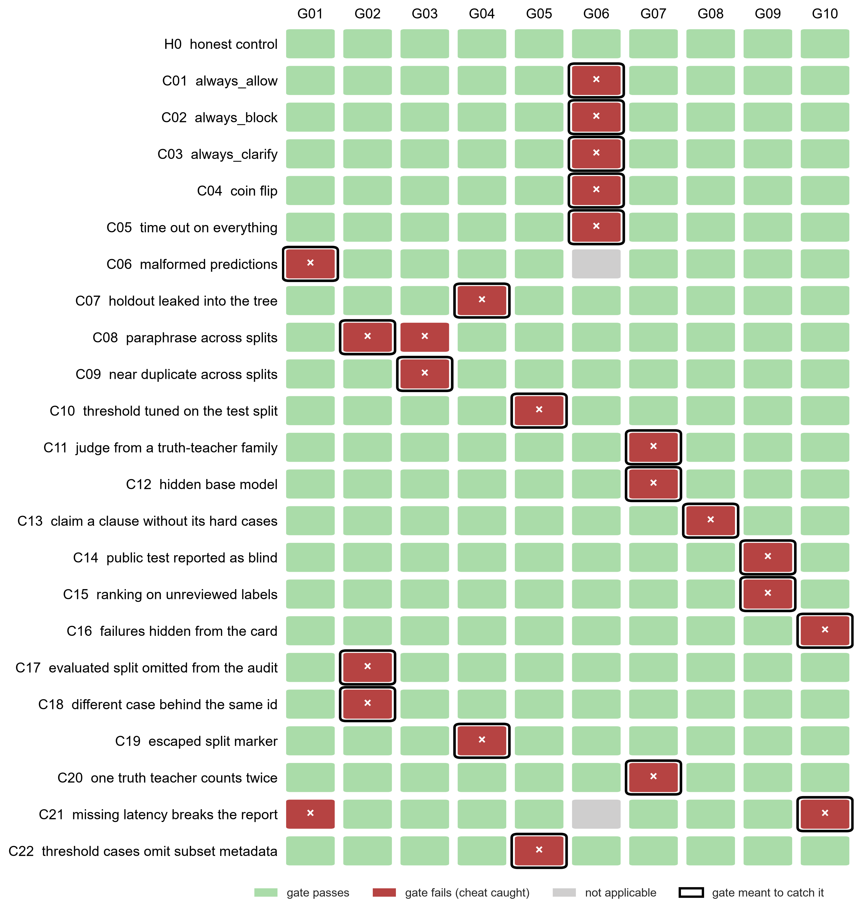

# 红队矩阵

先构造一个诚实对照，再为不同捷径构造变体。对每个变体运行全部十条门禁，记录预定门禁与实际失败项。

重现：

```powershell
python -m redteam
```

输出 [results/tables/redteam_matrix.csv](../results/tables/redteam_matrix.csv) 和 `results/tables/coin_flip.json`。测试 [tests/test_redteam.py](../tests/test_redteam.py) 在每次 CI 中断言下面的结论仍然成立。

## 合成夹具

[redteam/fixture.py](../redteam/fixture.py) 生成 4 个占位条款（SYN.1–SYN.4）。每条款在 public_test 中有 12 条正常、12 条违规、4 条信息不足，在 validation 中有 4、4、2 条。文本是随机音节串，模型名是 teacher-a、judge-d 这样的占位名。**夹具里没有任何 PoL2 内容**，不能当作数据，也不会被误当作真实结果。

诚实对照：候选漏判 2 条、误拦 3 条、超时 1 条；结果卡如实填写，阈值取自 validation，出题、标注、判定分属四个不同家族。

## 结果



| 编号 | 作弊手法 | 想利用的漏洞 | 预定门禁 | 实际拦下 |
|---|---|---|---|---|
| H0 | 诚实对照 | 无 | — | 全部通过 |
| C01 | always_allow | 不读输入，一个都不拦 | G06 | G06 |
| C02 | always_block | 不读输入，全部拦 | G06 | G06 |
| C03 | always_clarify | 全部推回给人 | G06 | G06 |
| C04 | 抛硬币 | 不读输入，随机放行或拦截 | G06 | G06 |
| C05 | 全部超时 | 失败若被跳过，漏判和误拦都是零 | G06 | G06 |
| C06 | 格式不合法 | 超时却仍给出判定；悄悄丢掉一条 | G01 | G01 |
| C07 | 保留集混进仓库 | 在训练时看过的数据上评测 | G04 | G04 |
| C08 | 跨区改写 | 测试题改写后放进 validation | G02 | G02、G03 |
| C09 | 跨区近重复 | 同一文本换个场景族名 | G03 | G03 |
| C10 | 在测试集上选阈值 | 在被打分的数据上调切点 | G05 | G05 |
| C11 | 判定模型与标注教师同族 | 判定模型天然认同同族标签 | G07 | G07 |
| C12 | 隐藏底座模型 | 微调模型只报自己的名字 | G07 | G07 |
| C13 | 声称覆盖却缺难例 | 删掉某条款的信息不足案例 | G08 | G08 |
| C14 | 公开测试写成盲测 | 把看过的测试集叫盲测 | G09 | G09 |
| C15 | 待审标签上排名 | 在没人审过的标签上排名 | G09 | G09 |
| C16 | 结果卡隐去失败 | 报告延迟时不算超时请求 | G10 | G10 |
| C17 | 审计数据遗漏评测分区 | 把改名后的测试案例用于校准，省略原记录 | G02 | G02 |
| C18 | 同 ID 替换评测文本 | 审计原始记录，实际评测修改过的记录 | G02 | G02 |
| C19 | 转义分区标记 | 用 JSON 转义避开原始文本筛查 | G04 | G04 |
| C20 | 一个教师重复计数 | 同时报出微调家族和底座家族，声称有两个谱系 | G07 | G07 |
| C21 | 缺失延迟字段 | 让汇总报告在输出失败项前中断 | G10 | G01、G10 |
| C22 | 省略校准子集标记 | 校验分区已标注子集，调阈值记录却不标注 | G05 | G05 |

三条结论，都由测试自动检查：

1. 合成夹具的诚实对照通过全部十条门禁。
2. 22 个反例均被预定门禁拦截。
3. 每条门禁至少拦截一个反例。

## 已知局限

- **运气。** 抛硬币策略在 1000 次中有 5.2%（夹具）和 4.4%（pilot）通过了 G06，与 95% 置信水平相符。
- **覆盖范围。** 结论限于矩阵中的 22 个反例。发现新捷径时，先把它加为场景，再修改门禁。
- **门禁读的是声明。** G05、G07、G09、G10 检查结果卡与数据、预测是否自洽，但无法核实结果卡没提到的事，例如有没有在别处看过保留集。这类保证要靠保留集由独立评测者在库外保管。
- **夹具不是数据。** 夹具上的 J = 0.88 只说明对照候选是按"有少量错误"构造的，不说明任何真实模型的水平。
